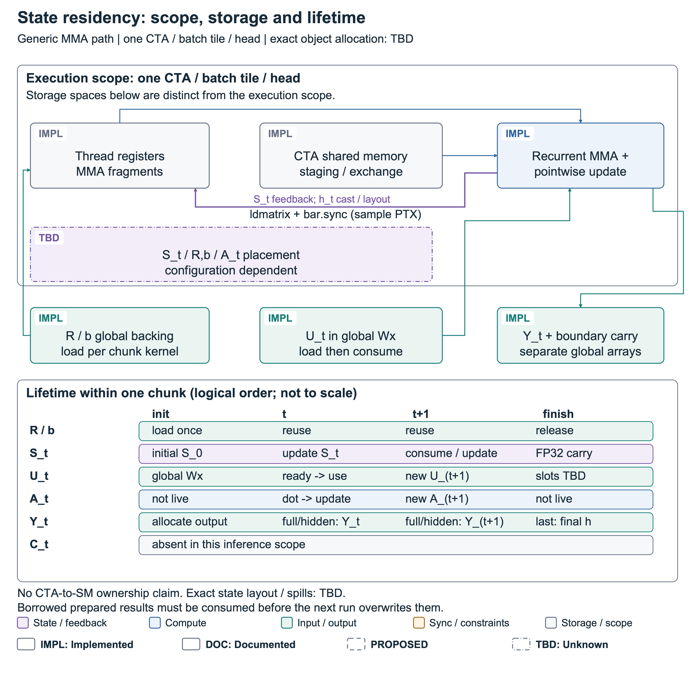

# FlashRNN2 architecture figures

本交付针对当前泛型 LSTM/sLSTM FP16/BF16 inference forward，选定一代 baseline 是固定 `0b84fc30120ecccbde97976bc5b086f3215572d2` 的 `triton_fused` 路径。二代判断绑定已读取源文件的 SHA，相关文件与冻结实验 manifest 一致。当前研究的优化目标包括状态精度、chunk 衔接、输出写出与资源组织；这些图没有把某个目标宣布为已测得的主导瓶颈，也没有加入新性能数字。

一代 Triton 路径已具有融合时间循环、权重重用、FP32 内部状态和 CTA 内反馈。图 01 用同构节点说明这些继承能力，并指出实际变化：可选的独立 FP32 computation carry、显式输出契约以及 full-call 初始化上下文。默认 full-state history 和 legacy 最后快照行为保留；hidden/last 属于调用者显式选择的结果范围。

图 02 将执行所有权与存储位置分开。每个 MMA CTA 覆盖 batch tile/head；状态在 chunk 内按源程序反馈，R/b 在 kernel 的时间循环前加载并复用。代表 PTX 的寄存器 fragments、shared-memory `ldmatrix` 和 `bar.sync` 是已观察编译证据。完整 S_t/R/b/A_t 的物理分配和 spill 归因仍是 TBD；这里没有“全部在寄存器”或“CTA 独占 SM”的结论。chunk boundary 的 FP32 global carry 与输出 history 分开，PreparedSequence 的借用结果必须在下一次 run 覆盖前消费。

图 03 保留同一 recurrence 的依赖：MMA_t 与 U_t 就绪后更新 S_t，下一次 MMA 等 h_t 的转换与 state ready，下一次 update 还依赖 c/n/m。它是 logical execution order，未用时间宽度代表真实延迟。独立 U_(t+1) 预取的候选 overlap 放在单独的 Proposed 面板；issue、complete、ready、consume、reuse 全部有约束，尚未证明独立资源、协议或有效重叠。

图 04 说明真实分派边界。ExecutionPolicy 是绑定 identity 的离线 exact-shape 表；缺失 key 使用既有 MMA16/4/B，错误 identity 明确报错。实验调用者显式传入 config 给 PreparedSequence；plan 检查语义、layout、CUDA device、D 适用域、output mode 与 chunk sum 后运行 MMA/SIMT。无合法支持的请求报错，没有自动连接所有一代 backends。能力/资源感知策略、fallback registry、cluster/WGMMA/FP8 是 Proposed，具体门槛与协议仍待实现或验证。

## 四张图与可复用文件

| Figure | 读者应理解的结论 | 屏幕版 | 论文版 |
|---|---|---|---|
| fig01_architecture_overview | 局部反馈是所选基线的已有机制；二代将输出快照与继续递归所需的 carry 分开。 | [SVG](figures/fig01_architecture_overview.svg) · [PNG](figures/fig01_architecture_overview.png) · [PDF](figures/fig01_architecture_overview.pdf) | [SVG](figures/paper/fig01_architecture_overview.svg) · [PNG](figures/paper/fig01_architecture_overview.png) · [PDF](figures/paper/fig01_architecture_overview.pdf) |
| fig02_state_residency | 常驻描述的是源程序在 chunk 内的重用；物理布局、spill、输出寿命和跨 chunk carry 分别有边界。 | [SVG](figures/fig02_state_residency.svg) · [PNG](figures/fig02_state_residency.png) · [PDF](figures/fig02_state_residency.pdf) | [SVG](figures/paper/fig02_state_residency.svg) · [PNG](figures/paper/fig02_state_residency.png) · [PDF](figures/paper/fig02_state_residency.pdf) |
| fig03_dependency_pipeline | 可重叠的是独立工作；同一 recurrence 的 MMA 必须等待所依赖的 state ready，buffer 复用必须晚于消费。 | [SVG](figures/fig03_dependency_pipeline.svg) · [PNG](figures/fig03_dependency_pipeline.png) · [PDF](figures/fig03_dependency_pipeline.pdf) | [SVG](figures/paper/fig03_dependency_pipeline.svg) · [PNG](figures/paper/fig03_dependency_pipeline.png) · [PDF](figures/paper/fig03_dependency_pipeline.pdf) |
| fig04_execution_dispatch | 实际 selector 是离线 exact-shape 表与保守 MMA fallback；更广的能力/资源/后端自动选择仍是候选。 | [SVG](figures/fig04_execution_dispatch.svg) · [PNG](figures/fig04_execution_dispatch.png) · [PDF](figures/fig04_execution_dispatch.pdf) | [SVG](figures/paper/fig04_execution_dispatch.svg) · [PNG](figures/paper/fig04_execution_dispatch.png) · [PDF](figures/paper/fig04_execution_dispatch.pdf) |

屏幕 PDF 宽 254 mm；论文 PDF 宽 178 mm，采用独立加大字号，最小字号 8.41 pt。PNG 为 2 倍画布尺寸。SVG 保留 text/tspan、稳定 id、data-claim/data-kind/data-status，没有嵌入位图。颜色表示对象类别，Implementation 状态靠文字 badge 和线型；灰度 proof 可在 checks/proofs 查看。

- [Evidence and scope](evidence.md)：23 条 claim、原路径/行范围/symbol/内容 SHA、15 份相关源码/设计/测量快照及已知限制。
- [中文 caption / alt text](captions_zh.md) 与 [English captions / alt text](captions_en.md)。
- [实际源码映射](code_map.md)、[验收记录](review.md)、[机器可读校验结果](checks/validation.json)。
- 单一语义来源 [architecture.json](architecture.json)，独立坐标/route [layouts.json](layouts.json)，共用 [style.json](style.json)。
- 绘图和验收代码在 src/；独立绘图依赖 requirements-diagrams.txt，不修改项目生产依赖。

## 重建与检查

在仓库根目录执行：

```bash
python -m venv docs/architecture/flashrnn2/.venv
# 系统需要可用的 Cairo；不包含或分发字体文件。
docs/architecture/flashrnn2/.venv/bin/python -m pip install -r docs/architecture/flashrnn2/requirements-diagrams.txt
docs/architecture/flashrnn2/.venv/bin/python docs/architecture/flashrnn2/src/write_docs.py --root docs/architecture/flashrnn2
docs/architecture/flashrnn2/.venv/bin/python docs/architecture/flashrnn2/src/run_diagrams.py all
```

本环境复用已有 Cairo 1.18.4 与 Poppler，CairoSVG 2.9.1 仅安装在本目录隔离环境。run_diagrams.py 在桌面 runtime 可用时发现其 Cairo 路径；普通系统直接使用已有安装。若调用原始入口，接口为：

```bash
python docs/architecture/flashrnn2/src/render_figures.py \
  --model docs/architecture/flashrnn2/architecture.json \
  --layout docs/architecture/flashrnn2/layouts.json \
  --style docs/architecture/flashrnn2/style.json \
  --out docs/architecture/flashrnn2/figures --formats svg,png,pdf
python docs/architecture/flashrnn2/src/validate_figures.py --root docs/architecture/flashrnn2
python docs/architecture/flashrnn2/src/inspect_exports.py --root docs/architecture/flashrnn2
```

Semantic / geometry checks 使用实际 Cairo font extents，不只按字数猜宽度。validator 检查 claim/source、SVG 可编辑性、几何、time-unrolled DAG 与全部已建模 consumer 完成后的 buffer 复用。自动检查不能替代视觉复核或 kernel 正确性测试。

## 仍需完成的架构研究

全形状 state layout / spill 归因、独立 prefetch 的资源与同步协议、实际 overlap trace、resource-aware 分派及合格 fallback、cluster 分片轴与通信、WGMMA operand remapping 和 FP8 数值资格仍待实现或测量。TiRex/xLSTM 的特定算术、backward 和 distributed 不属于本套 generic 图的已实现范围。出图全部完成，不等同于这些科学问题已解决。

## Preview





